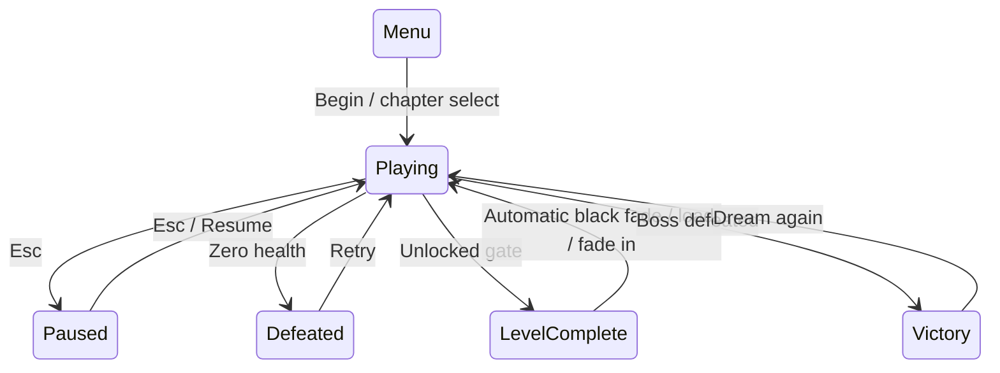
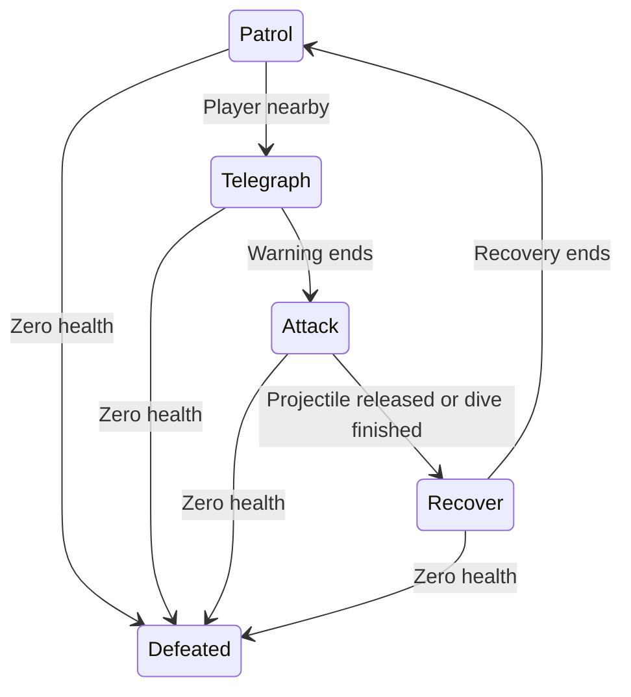
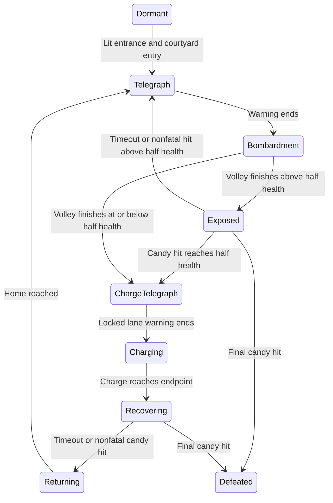

# Lanterns of the Lost Dream — Prototype design v0.13

## High concept

A dreamwalker crosses a Halloween dream disappearing into nightmare fog. Pumpkin lanterns restore missing roads. A bow clears flying nightmares; candy breaks the Pumpkin King's exposed shell. Win by restoring three dream chapters and defeating the boss inside his castle.

**Genre:** short single-player 3D action adventure with environmental switching and light puzzles. **View:** lower third-person perspective follow camera, inspired by the user's It Takes Two reference. **Prototype target:** keyboard/mouse on macOS. **Visual tone:** purple floating islands, warm pumpkin light, teal restored paths, pink/blue/gold candy and boss hues.

The user's updated concept is four chapters, lanterns revealing roads or dispersing nightmares, bow combat against small flying dragons, and a castle pumpkin boss attacked with collected candy after dodging bombs. The precise rules, counts, controls, and timings below are implementation proposals for playtesting.

## Game script

### 1 — The First Light

The player appears on a floating island. The title screen explains controls. A gold practice rune introduces aiming and the bow. A pumpkin lantern near the northern edge reveals two wide round platforms with visible landing rims. A sign teaches Space to jump; directional input adjusts the airborne landing point. The second connection retains its lantern-restored bridge. The next island introduces a moving dragon and another lantern. The final island supplies wrapped candy and a pink seal: E picks up candy; right-click throws it. Until the pink seal is broken, refill the final island’s two candy spots every three seconds. Each spot holds at most one pickup; held candy, unlit lanterns, and candy elsewhere do not block replenishment. Pause freezes the timer. Clearing both lanterns, the dragon, and both seals opens the exit to chapter 2.

### 2 — Shattered Gardens

Recover three lost memories across seven islands. Eleven flying guardians include ember and evolved dragons, slow-orb ghosts, fan-shot bees and diving demons. Take the west Whisper Grove branch, then the east Moon Observatory branch to shoot the I → II → III moon melody, then the west Candy Crypt branch to break its candy seal. Six lanterns and four round-platform routes connect exploration, combat and puzzles. Terrace/Observatory lights require one recovered memory; Gate/Crypt lights require two. Crypt supplies replenish every three active seconds. All memories, lanterns, guardians and runes are required before the enclosed iron gate opens and lights its exit trail.

### 3 — Witchlight Marsh

A teal, mushroom-lit route introduces potion recipes and environmental timing before the castle. Cross six islands: the landing, Glowcap grove, witch's workshop, breathing marsh, abandoned watchtower and castle road. Use colored candy to brew Moonwake (PINK → BLUE), Starlight (BLUE → GOLD) and Dawnbloom (GOLD → PINK → BLUE). Each pot displays the full recipe and next ingredient. Arrows and wrong colors do not advance or reset accepted ingredients. Three designated candy spots replenish and restore their respective colors every three active seconds, including after swaps leave wrong-colored stock on the floor.

Each potion and its three guardians unlock the next lantern. The workshop and marsh have marked vents: a gold 1.5-second warning precedes two seconds of low damaging mist. Jump or go around its marked radius; brewing the local potion permanently dispels it. Five jumping crossings link the islands, with one sideways drifting stone in each of the last three. Grounded characters ride with the platform. The watchtower's three guardians guard the final lantern. The exit requires three potions, twelve defeated guardians and five lanterns. Falls preserve progress; retry resets the chapter. See [map and editing details](WITCHLIGHT_MARSH.md).

### 4 — The Pumpkin Keep

A lantern reveals two narrow raised round platforms across the castle approach, requiring two platform landings followed by a jump into the courtyard. Entering the courtyard wakes the Pumpkin King. He gives a warning, then sends falling pumpkin bombs; orange circles mark blast radii. Move out or dash while collecting glowing candy. In the first half, each volley opens his face for four seconds. Candy must match his current body hue. One accurate matching-color candy throw removes one of six health points and closes that window. Arrows and protected-phase candy do no damage.

The boss calls reinforcements exactly twice: at awakening, one ember dragon and one ghost; at the hit that reaches half health, one evolved dragon and one diving demon. Each wave has two seconds of visible floor-ring warning and samples actual courtyard ground away from the player and boss. Boss bombs and charges continue during the summon warning and while enemies attack. Use arrows on the reinforcements and matching candy on the boss; clearing enemies is not a shield or a requirement for the boss's vulnerable window. Defeated reinforcements drop the currently required candy hue on ground near their home position. There are at most four summoned enemies across the fight and no periodic replacement waves. Pause freezes summon windup; retry resets both waves. Defeat and victory cancel pending summons and remove reinforcements and hostile projectiles.

The hit that reduces health to 3/6 immediately unlocks his first charge. A 1.6-second warning marks a broad ground lane aimed at the player's initial position; moving afterward does not redirect it. The head then charges at 15 units per second, dealing at most one health point per charge and respecting normal dash/post-hit immunity. Its stone dais remains fixed. The endpoint stays within the courtyard. Move sideways or use Shift; the ordinary jump cannot clear the head's height. Afterward, the boss stops and turns its face toward the player, opening the matching-color weak point for 2.4 seconds. A nonfatal candy hit or the window's end closes the shell and sends it home. Later cycles use four bombs with shorter fuses followed by another charge; bomb explosions finish before the charge warning. Defeat clears bombs and charge warnings and displays victory.

### Candy color matching

Start with PINK [O] as the sole required and supplied color. The first successful hit unlocks BLUE [<>] and makes it the next required hue; the second unlocks GOLD [*] and makes it next. All three hues have therefore been introduced before half-health charges. After introduction, required hues rotate between attack cycles. Above-half-health missed windows also rotate among currently unlocked hues; at full health, a missed window keeps pink. The hit that reaches half health begins a new charge cycle in the next hue. A nonfatal recovery hit chooses the next hue for the return/new attack, while an unanswered recovery changes hue only after returning home.

During a single bomb/charge sequence and its vulnerable window, the hue stays fixed. The head's ribs, candy bodies/rings, HUD required-color text, held-candy display and reticle show the hue. Text names and distinct symbols supplement the colors. Nearby floor labels are hidden behind solid scenery or the boss so they cannot suggest a different color over its face. Open-shell state is separately shown as SHELL OPEN or STUNNED; a matching color alone does not make a closed shell vulnerable. Wrong candy is consumed with no damage, gives mismatch feedback, and leaves the vulnerable window open. Arrows cannot damage the boss.

E at a different-colored pickup swaps it with the held candy, leaving the previous sweet on the floor. Same-color pickups are skipped while carrying candy, so nearby lamps and different colors remain interactable. Boss supplies refill on the four-second timer and on color/window boundaries. Safe floor points outside the head's current footprint provide at least two required-color sweets, with the remaining slots used for other unlocked hues. A full floor of wrong colors cannot block matching supply: floor colors are rebalanced when needed; held and in-flight candy never changes hue. The tutorial still supplies ordinary pink candy every three seconds until its seal clears.

## Rules and feedback

| System | Rule | Feedback |
| --- | --- | --- |
| Lantern | E nearby; permanent bridge activation; heal 1; save checkpoint | Flame, warm light, teal road, sound, counter, message |
| Bow | Unlimited arrows; 0.38 s cooldown; projectile collision; current-frame center-reticle aiming | Arrow trail, shot sound, health indicator, hit burst |
| Candy | Carry one; E pickup/exchange; ballistic throw retains hue; consumed on throw | Held hue, names/symbols, floor labels and pickup/throw sounds |
| Flying nightmares | Eleven garden and twelve marsh encounters, four behavioral species; patrol, warning, attack, recovery | Imported animated models, species names, warning hints, distinct projectiles and dive lane |
| Jump | Space: 2.2-unit grounded jump, gravity and head collision; no double jump or immunity | Takeoff, airborne leg tuck and landing compression |
| Round platforms | Lantern-activated jumping routes; flat tops, empty gaps and drifting stones in the marsh | Cyan landing rims, gold center dots, entry/exit rings and Space instructions |
| Dash | Shift: 0.22 s dash; 1.05 s cooldown; damage immunity during dash | Teal burst, sound, readiness indicator |
| Health | 5 points; 1.05 s post-hit immunity; retry at zero | Health segments, flashing character, hurt sound |
| Fall | Lose 1 health; return to checkpoint | Return and explanatory message |
| Boss supply | Random safe floor positions outside head footprint; target four pickups with two matching sweets | Colored floating wrappers and short nearby labels |
| Boss matching | Candy hue must match while shell is open; wrong color consumes candy without damage or closing the window | Body hue, separate open/closed state, required name/symbol and mismatch toast |
| Boss charge | Unlock at 3/6 health; 1.6 s locked-lane warning; one-point contact damage; 2.4 s exposed recovery, then return home | Marked corridor and arrow, warning sound, HUD phase instructions and exposed face |
| Boss reinforcements | Two one-time waves, each one dragon and one monster; boss attacks concurrently; arrows defeat minions | Two-second portal rings, WAVE counter and living-enemy count; matching candy reward |
| Exit | All chapter objectives required; walk through without confirmation | Iron leaves open, floor glows, black fade loads and resumes next chapter |

The lantern is a spatial switch: activation changes where the player can physically travel. This version uses readable single-lantern/single-crossing relationships for bridges and round platforms; ordering puzzles can follow core-loop playtesting.

## State machines

Player movement combines locomotion, grounded jump, grounded dash, attack pose, post-hit immunity, carrying candy, and falling recovery. Chapter states control whether player actions are accepted. The player uses Mixamo's Timmy Humanoid rig with idle/run blending and masked aiming/throwing clips; movement stays with the CharacterController, and bow/candy follow animated hands. Candy carrying adds a procedural arm target. Bow aiming squares the chest with the shot direction, extends the left arm forward and keeps the right hand beside the face with a two-bone solve; arrows originate at the bow grip. Boss animation is procedural. Flying enemies use Quaternius's imported skeletons and flight, attack, and death clips; a separate orange charge ring preserves attack-warning readability.

## Next decisions

### Background score

Exploration and the title screen use an original melodic dream score. Courtyard awakening crossfades to the boss score; reaching half health crossfades to a faster, denser arrangement. Each score loops, with event effects on a separate audio source. Pause holds the music playback position; resume continues it. M mutes music and effects together and retains that preference through retries and chapter changes. Level completion, defeat and victory fade the score out. `DreamAudio.musicVolume` allows volume tuning in the Inspector. Music sources are recreated with the scene, so retries do not accumulate loops.

The prototype includes beginning-to-victory progression, sounds, checkpoints, retry, pause, mute, and chapter selection. There is no persistent save, controller support, or complex lantern ordering puzzle yet. Test camera scale, aiming, bridge width, bomb timing, and the readability of the vulnerability cue before expanding scope.

## Four-chapter pacing target

Budget roughly 1.5–2 minutes for the tutorial, 3–4 for the gardens, 3–4 for the marsh and 2–3 for the Boss. These are design estimates, not measured first-time play durations or a guaranteed ten-minute minimum. Validate with timed human playthroughs. Add meaningful traversal, recipe decisions and combat instead of mandatory waiting.
